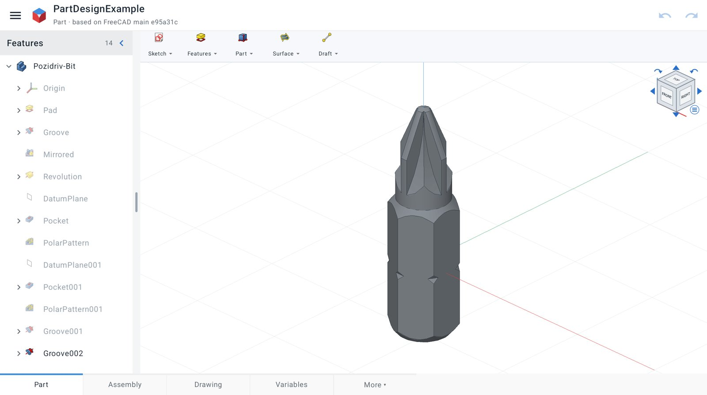

# MobileCAD

CAD for Android phones and tablets, built on [FreeCAD](https://www.freecad.org)'s modelling engine with a touch-first interface.

**[Website](https://lucascoraca.github.io/mobilecad/)** · **[Download the latest APK](https://github.com/LucasCoraca/mobilecad/releases/latest)** · Android 8 or newer, about 1 GB free space



MobileCAD is an independent project. It is **not affiliated with, sponsored or endorsed by** the FreeCAD project or the
FreeCAD Project Association; "FreeCAD" is their trademark and is used here only to say what MobileCAD is built on.

## License

MobileCAD is free software: GNU General Public License v3.0 or later (see `LICENSE`). It includes FreeCAD
(LGPL-2.1-or-later), Open CASCADE Technology (LGPL-2.1 with exception), Qt 6 (LGPL-3.0), Gmsh (GPL-2.0-or-later),
CalculiX (GPL-2.0), IfcOpenShell (LGPL-3.0) and other components; the app's *About ▸ Open-source licenses* screen lists them all with their
license texts (generated by `release/gen_notices.py`). FreeCAD's command icons are LGPL-2.1-or-later, with the
exceptions credited in `app/app/src/main/assets/licenses/freecad-icons.txt`.

The corresponding source of every release is this repository plus the archives attached to each
[GitHub Release](https://github.com/LucasCoraca/mobilecad/releases): FreeCAD at the commit built with our patch, and the
(L)GPL dependencies (Open CASCADE, Qt, Gmsh, CalculiX, MED, IfcOpenShell), made by `release/make_source.sh`.

## Layout

| Path | What |
|---|---|
| `app/` | Android app (Kotlin / Jetpack Compose UI, JNI bridge in `app/app/src/main/cpp`) |
| `engine/` | Cross-build scripts for FreeCAD and its dependencies, patches, and the Python bridge (`engine/python/mobilecad`) |
| `research/` | Generators for the command catalog from FreeCAD's sources |
| `branding/` | Logo (`make_logo.py` generates the SVG master and the app's vector icons) |
| `release/` | License notices, source archives, website (`make_site.py`), screenshots (`shot.sh`) and launch video (`video/`) |
| `docs/` | The website, served by GitHub Pages (generated: `python3 release/make_site.py --github`) |

## Building

Build the native runtime with `engine/build_deps.sh` and `engine/build_freecad.sh` (Android NDK 29, per ABI), stage
it with `engine/package_runtime.py <abi> app`, then build the APK with Gradle:

```sh
cd app && ./gradlew :app:assembleArm64Release     # or :app:assembleX86Debug for the emulator
```

Release builds are signed when `~/Android/keys/mobilecad-release.properties` exists (`storeFile`, `storePassword`,
`keyAlias`, `keyPassword`); otherwise they come out unsigned.
